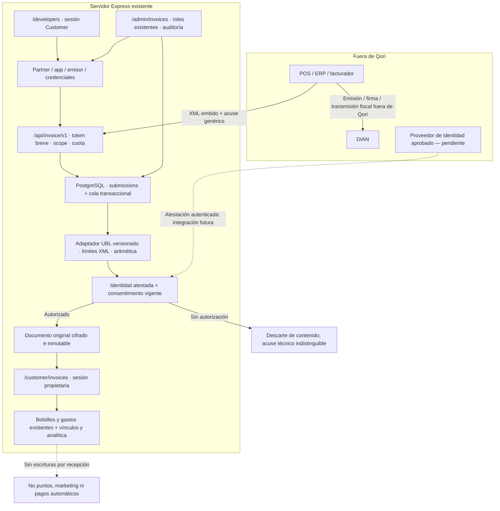

# Arquitectura y decisiones
Fecha de contraste: 2026-11-22. Este documento diferencia software sandbox del objetivo productivo. No representa homologación, certificación DIAN ni despliegue.

## Matriz existente / reutilizar / extender / crear
| Dominio | Existente | Reutilizar | Extender | Crear |
|---|---|---|---|---|
| Identidad personal | customer_accounts/sessions, correo/contraseña/OAuth | customerAuthService y CSRF | Atestaciones independientes, país/tipo, revisión de colisiones | Solicitud de revisión documental sin imágenes |
| Developers | Cuenta personal Qori | Sesión y registro Customer | Perfil de integrador/membresías, roles, revisión | Consola /developers, apps y credenciales |
| Empresa/Seller | JWT app_users, adminAccessPolicy, roles, subscriptions | Solo auth administrativa autorizada | Navegación a consola de revisión | Ningún usuario/negocio/suscripción paralelo |
| Fiscal | Referencias de factura en redenciones; no UBL | Identificadores de movimiento cuando conciliados | Adaptadores fiscales versionados | Documento inmutable cifrado y modelo canónico |
| Finanzas | customerFinance, books, entries, business_sales | Categorías, bolsillos, gastos propios, venta canónica | Vínculos, analítica documental y overrides | No contabilidad ni pagos paralelos |
| Avisos | Beneficios ligados obligatoriamente a businesses | Patrón de bandeja y preferencias | Bandeja documental personal | Aviso sin FK empresarial; no puntos |
| Operación | PostgreSQL/pg, migraciones duales, node:test | Transacciones, RLS cerrada, pool, tests | Cola, cuotas, acuses y auditoría | Solicitudes de homologación/privacidad |
| Despliegue | Express/Render, gosqori.com en configuración | Infraestructura y rutas relativas | Feature flag cerrado, rollback | Ningún dominio nuevo |

## Arquitectura objetivo y límites de confianza


## Secuencia de emisión, transmisión y validación
```mermaid
sequenceDiagram
 actor Comprador
 participant POS as Facturador / conector
 participant DIAN
 participant OAuth as Token endpoint Qori
 participant API as Invoice Gateway
 participant DB as Cola PostgreSQL
 participant W as Worker UBL
 Comprador->>POS: Solicita canal complementario Qori
 POS->>DIAN: Emite / firma / transmite según obligaciones propias
 DIAN-->>POS: Respuesta fiscal (fuera del alcance Qori)
 POS->>Comprador: Entrega legal de factura y soportes
 POS->>OAuth: client_credentials (credencial servidor)
 OAuth-->>POS: Token breve y scopes
 POS->>API: POST invoices + XML + Idempotency-Key
 API->>API: Token, scope, emisor autorizado, cuota, tamaño
 API->>DB: Transacción: idempotencia + XML cifrado + trabajo
 DB-->>API: Confirmación durable
 API-->>POS: 202 + submission_id opaco
 W->>DB: FOR UPDATE SKIP LOCKED
 W->>W: XML sin red/DTD, adaptador, estructura y aritmética
 Note over W: Parsear no confirma firma ni DIAN; evidencia reported/unverified
 W->>DB: Resultado técnico, reintento acotado o rechazo
 POS->>API: GET receipts/submission_id
 API-->>POS: ACCEPTED / PROCESSED / REJECTED sin datos del comprador
```

## Secuencia de identidad, consentimiento y primera factura
```mermaid
sequenceDiagram
 actor Persona
 participant Customer
 participant Identidad as Verificación independiente
 participant Consent as Registro de consentimiento
 participant Conector
 Persona->>Customer: Sesión Qori verificada por correo
 Persona->>Customer: País, tipo, número; solicita revisión
 Customer->>Identidad: Prueba proporcional sin guardar copia de cédula
 Note over Identidad: Producción pendiente de proveedor/contrato; sandbox solo fixture local
 Identidad-->>Customer: Atestación con evidencia, vigencia o colisión en revisión
 Conector-->>Persona: Enlace genérico a Customer y app (sin cédula)
 Persona->>Customer: Activa recepción para app, comercio opcional y bolsillo
 Customer->>Consent: Texto/version/hash/finalidades/fecha, marketing excluido
 Customer-->>Persona: Recepción autorizada y opción de revocar
 Persona->>Conector: Puede reenviar primera factura con nueva operación
 Note over Conector,Consent: Un envío previo descartado no se entrega retroactivamente
 Persona->>Customer: Revoca
 Customer->>Consent: Revocación transaccional; también afecta cola pendiente
```

## Secuencia de asignación y actualización financiera
```mermaid
sequenceDiagram
 participant Worker
 participant DB as Identidad / consentimientos / documentos
 participant Inbox as Bandeja Customer
 actor Persona
 participant Ledger as Gastos existentes
 Worker->>DB: Revalidar emisor, identidad, consentimiento, país/tipo y bolsillo
 alt Sin autorización o identidad suficiente
  Worker->>DB: Borrar payload identificable; conservar acuse mínimo
 else Autorizado
  Worker->>DB: Dedupe emisor+tipo+UUID y hash; transacción
  alt Misma identidad fiscal, contenido distinto
   Worker->>DB: Revisión interna; no sobrescribir original
  else Documento nuevo
   Worker->>DB: XML cifrado, normalización, aviso interno
   DB-->>Inbox: Documento y detalle para su propietario
  end
 end
 Persona->>Inbox: Consulta filtros, líneas y compras por periodo
 Inbox->>DB: Lectura propietaria; notas relacionadas ajustan compras
 Note over Ledger: Recibir factura no crea egreso ni pago
 Persona->>Inbox: Corrige categoría
 Inbox->>DB: Override personal con valor original, método y confianza
 Persona->>Inbox: Vincula un gasto ya registrado
 Inbox->>Ledger: Comprueba propietario, bolsillo, moneda, importe
 Inbox->>DB: Vínculo de procedencia único; no insertar otro gasto
```

## ADR
- **ADR-001: infraestructura.** Módulo Express/CommonJS, PostgreSQL existente y rutas relativas. Sin microservicios ni duplicación de identidades en esta etapa.
- **ADR-002: recepción canónica.** Solo POST /api/invoice/v1/invoices. GET /receipts/:id es acuse técnico, no acceso a la factura. submission_id es opaco.
- **ADR-003: autenticación.** Client Credentials para servidores, tokens opacos breves, secretos hasheados y claves por entorno. Sesiones Customer para Developers. Nada de secretos M2M en playground o almacenamiento de navegador.
- **ADR-004: prueba de identidad.** Correo, documento declarado y factura no prueban titularidad. Sin endpoint de autoverificación. País+tipo+número forman la clave HMAC. Colisiones suspenden asignación hasta resolución humana; cambio exige nueva prueba y nuevos consentimientos.
- **ADR-005: consentimiento conservador.** Por aplicación; admite restricción por emisor. Apagado por ausencia de consentimiento. Global para proveedores adheridos solo después de definir base legal y política de adhesión. No marketing, perfilado publicitario ni acceso al historial por el comercio.
- **ADR-006: pago.** Documento y movimiento financiero son distintos. Se conserva ledger existente. Conciliación explícita; automatizar coincidencias sin identificador fiscal común sería inseguro.
- **ADR-007: parsing.** UBL 2.1 / perfil DIAN 1.9 como referencia versionada, no constante jurídica inmutable. Sin consultas remotas desde XML, sin ZIP, sin validar firma mediante un booleano reportado.
- **ADR-008: contenedor.** AttachedDocument se extrae sin ejecutar URLs. Asociados se conservan cifrados, con evidencia reportada no verificada. XSD/Schematron/firma/cadena/certificados siguen siendo gates de producción.
- **ADR-009: callbacks.** El piloto técnico usa polling. Webhooks salientes no se habilitan por defecto; diseño firmado y defensa SSRF en runbook. No introducir una superficie de red sin necesidad acordada.
- **ADR-010: aislamiento.** Sandbox solo identificadores sintéticos y rutas deshabilitadas en NODE_ENV=production. Una aprobación administrativa de revisión jamás crea tráfico o credenciales productivas.
- **ADR-011: permisos.** La administración hereda authRequired, identidad administrativa y roles reales; no se amplían cuentas privilegiadas ni se inventa 2FA. Falta 2FA verificable: gate previo al piloto real.
- **ADR-012: almacenamiento.** XML y datos sensibles cifrados; normalización como snapshot versionado dentro del documento, no docenas de tablas duplicadas. Overrides/eventos/vínculos se indexan aparte para integridad y auditoría.
