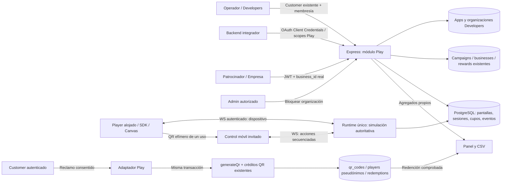

# Arquitectura y decisiones

Estado: sandbox local integrado sobre 06391dd. La auditoría precedió a los cambios. No existe una ruta productiva habilitada.



## Emparejamiento y campaña

```mermaid
sequenceDiagram
 participant P as Player
 participant O as Operador
 participant A as API Play
 participant S as Patrocinador
 participant DB as PostgreSQL
 P->>A: Crear desafío
 A->>DB: Hash del código y desafío, TTL 2 min
 A-->>P: Código visible + desafío privado
 O->>A: Confirmar código sobre pantalla propia
 A->>DB: Verificar app, organización, pantalla y consumo
 P->>A: Canjear desafío
 A->>DB: Consumir una vez; rotar hash de dispositivo
 A-->>P: Token limitado a pantalla, 24 h
 S->>A: Autorizar app para campaign propia
 O->>A: Crear configuración Play en borrador
 S->>A: Aprobar contenido, juego, límites y presupuesto
 A->>DB: Hash de configuración aprobada y auditoría
 O->>A: Asignar campaña aprobada a pantalla propia
```

## Consentimiento, turno y resultado

```mermaid
sequenceDiagram
 participant P as Player
 participant M as Móvil
 participant A as API / Runtime
 participant DB as PostgreSQL
 P->>A: Autenticar WS con capacidad de dispositivo
 A-->>P: Campaña y QR efímero
 P-->>M: Fragmento de unión; no identidad
 M->>A: Aceptación explícita, versión y declaración 18+
 A->>DB: Bloquear pantalla y ticket; consumir ticket
 alt Pantalla ocupada
 A-->>M: QUEUED, posición privada
 else Disponible
 A->>DB: READY, semilla privada
 end
 M->>A: start, seq 1
 loop Partida
 M->>A: Acción permitida + secuencia
 A->>DB: Validar actor, turno, caducidad y transición
 A->>A: Avanzar simulación con reloj servidor
 A-->>P: Estado público sin identidad
 A-->>M: Estado privado sin solución de memoria
 end
 A->>DB: Resultado verificado + eventos idempotentes
 A->>DB: Reserva atómica si hay cupo y presupuesto
 A-->>M: Resultado; beneficio solo si fue reservado
 A->>DB: Promover siguiente participante
```

## Reclamo y redención

```mermaid
sequenceDiagram
 participant C as Customer
 participant A as Adaptador Play
 participant DB as Transacción PostgreSQL
 participant Q as Motor QR existente
 participant V as Validator existente
 C->>A: Sesión Customer + capacidad de partida + consentimiento separado
 A->>DB: Bloquear partida, reserva y campaña; comprobar titular del reclamo
 alt Ya emitido para este Customer
 A-->>C: Misma referencia QR
 else Reserva vigente
 A->>Q: generateQr(datos pseudónimos, actor juego, transactionClient)
 Q->>DB: Validar campaña, consumir crédito y crear QR
 A->>DB: Asociar Customer privadamente y marcar ISSUED
 A-->>C: Referencia privada; nunca QR al operador/pantalla
 end
 C->>V: Presentar beneficio por flujo existente
 V->>DB: Validación y redención según reglas existentes
 DB-->>A: Analytics consulta redemptions; no infiere venta
```

## ADR

- **P-001 — Extender Developers.** Reutilizar invoice_partners/members/apps/keys/access_tokens. Los nombres históricos no cambian. Scopes Play son optativos; defaults Invoice se conservan.
- **P-002 — Una instancia autoritativa.** ws 8.22.1, lease PostgreSQL y estado durable. Un segundo runtime no procesa juegos. No se utiliza una cola distribuida ni se afirma escalabilidad horizontal.
- **P-003 — Plugins incorporados.** games.js contiene manifest, initial, step y visible. Versión 1 persistida por partida. Agregar un juego requiere revisión de código, catálogo y migración de la restricción; no scripts externos.
- **P-004 — Resultado servidor.** El móvil no envía score, tiempo, victoria ni complete. Órbita avanza cada 100 ms; el runtime publica cada 250 ms y tras inputs aceptados. Secuencia oculta la solución al controlador.
- **P-005 — Campaña base única.** play_campaigns es una configuración de juego vinculada a campaigns mediante mandato del patrocinador; no reemplaza la campaña comercial.
- **P-006 — Beneficio promocional.** generateQr acepta un cliente transaccional opcional. Se conserva el comportamiento de dos argumentos. No se crean puntos, bonos monetarios, ventas ni cobros.
- **P-007 — Solo laboratorio.** NODE_ENV test/development + flag + DB loopback llamada qori_play_qa. Negocios de fixture con settings.qori_play_synthetic=true. Se respeta la restricción de empresa demo única de Seller; no se reutiliza is_seller_demo.

## Modelo aditivo

| Tabla | Función y restricción principal |
| --- | --- |
| play_organizations | Habilitación de partner existente |
| play_locations | Sede dentro del partner |
| play_screens | FK compuestas partner/app y partner/sede; hash único de dispositivo |
| play_pairings | Código y desafío hash únicos; expiración y consumo |
| play_sponsors | Mandato app/campaña único; actor y vencimiento |
| play_campaigns | FK app/mandato; configuración aprobada, juego y límites |
| play_assignments | Una campaña por pantalla; FK compuestas de app |
| play_join_tickets | Capacidad de unión hash; copia AES autenticada para mostrar QR mientras vive |
| play_sessions | FK app/pantalla/campaña; índice parcial impide dos jugadores activos |
| play_reward_grants | Una reserva por partida, un QR y un reclamo por Customer/campaña |
| play_events | Dedupe único; índices por app, pantalla, campaña, sesión y fecha |

Las once tablas tienen RLS y revocación de privilegios públicos/anon/authenticated. No hay políticas Data API. El backend usa SQL parametrizado y autorización explícita por objeto. RLS no sustituye esos controles al operar con el rol de servicio.

Estados de sesión: QUEUED → READY → PLAYING → COMPLETED/FAILED. PAUSED y DISCONNECTED permiten recuperación breve. EXPIRED termina abandono, caducidad, revocación y campaña inválida. idle pertenece a pantalla, no a una partida. El runtime promueve automáticamente la cola; no hay multijugador simultáneo.
